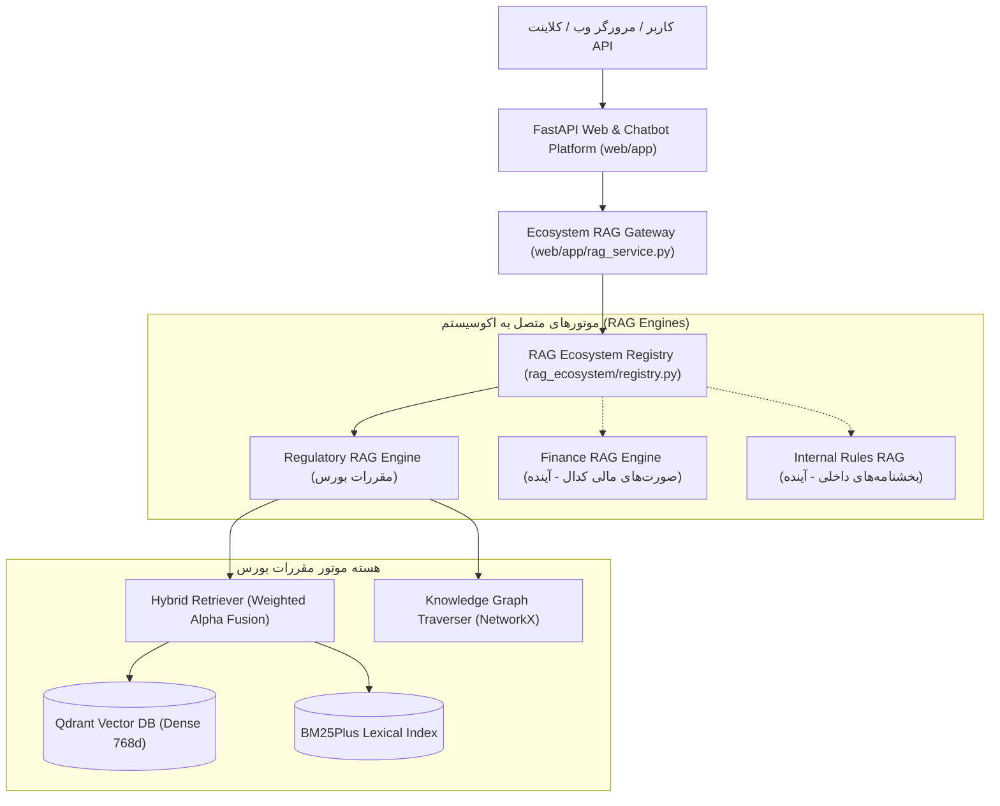
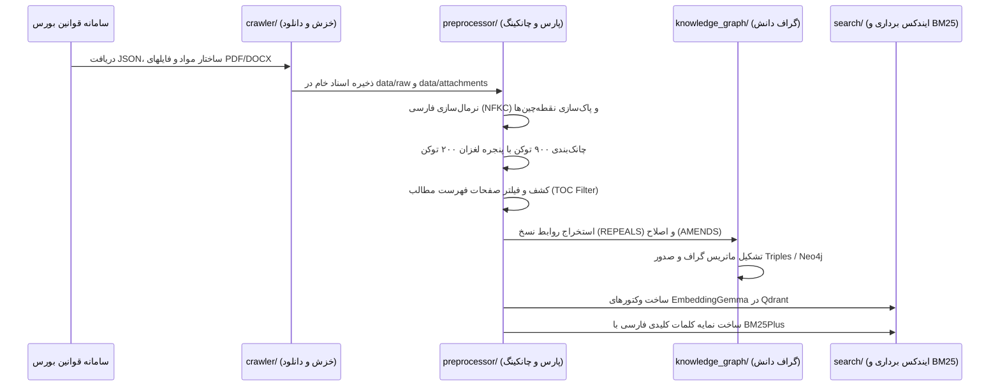

# 🏛️ اکوسیستم یکپارچه RAG و گراف دانش حقوقی بازار سرمایه
## Regulatory Knowledge Graph & Multi-Domain Hybrid RAG Ecosystem

این سامانه، یک پلتفرم جامع، چندلایه‌ای و قابل توسعه برای **استخراج، پردازش، تحلیل ساختار حقوقی، مدل‌سازی گراف دانش و پاسخ‌گویی استنادی هوشمند** بر پایه قوانین، مقررات، آیین‌نامه‌ها، دستورالعمل‌ها، بخشنامه‌ها و پیوست‌های رسمی سازمان بورس و اوراق بهادار ([cmr.seo.ir](https://cmr.seo.ir)) است.

پروژه به صورت یک **اکوسیستم باز (Pluggable RAG Ecosystem)** طراحی شده که در آن چندین موتور RAG مختلف در دامنه‌های گوناگون (مانند مقررات بورس، صورت‌های مالی، قوانین تجاری و ...) می‌توانند در یک پلتفرم واحد ثبت، مدیریت و در یک رابط کاربری پیشرفته چت‌بات عرضه شوند.

---

## 📑 فهرست مطالب
1. [معماری اکوسیستم و رجیستری چند RAG](#-۱-معماری-اکوسیستم-و-رجیستری-چند-rag)
2. [چرخه آماده‌سازی داده‌ها (Data Pipeline)](#-۲-چرخه-آماده‌سازی-داده‌ها-data-pipeline)
3. [موتور بازیابی چندمعیاره و گراف دانش (Retrieval Engine)](#-۳-موتور-بازیابی-چندمعیاره-و-گراف-دانش-retrieval-engine)
4. [رابط کاربری و چت‌بات یکپارچه (Web Chatbot UI)](#-۴-رابط-کاربری-و-چت‌بات-یکپارچه-web-chatbot-ui)
5. [راهنمای راه‌اندازی و اجرا](#-۵-راهنمای-راه‌اندازی-و-اجرا)
6. [راهنمای توسعه‌دهندگان: نحوه اتصال RAG جدید](#-۶-راهنمای-توسعه‌دهندگان-نحوه-اتصال-rag-جدید)

---

## 🏗️ ۱. معماری اکوسیستم و رجیستری چند RAG

سیستم به گونه‌ای مهندسی شده که فرانت‌اند و لایه پردازش از پایگاه‌های داده ایزوله هستند. یک **رجیستری مرکزی (`RAGEcosystemRegistry`)** تمام موتورهای بازیابی را مدیریت می‌کند:



---

## 🔄 ۲. چرخه آماده‌سازی داده‌ها (Data Pipeline)

آماده‌سازی داده‌ها در این سامانه طی ۵ مرحله خودکار و مهندسی‌شده انجام می‌پذیرد:



### جزئیات گام‌های آماده‌سازی:
1. **خزش اسناد و پیوست‌ها (`crawler/`):**
   - اتصال مستقیم به REST API سامانه با مدیریت محدودیت نرخ (`Rate Limiter`) و بدون قطعی در برابر فیلترشکن.
   - استخراج ساختار مصوبات، متون مواد، ارجاعات تنقیحی و دانلود مستقیم فایل‌های اصلی PDF و DOCX پیوست.
   - کشف و پیشگیری از خطای نام فایل طولانی (`[Errno 36] File name too long`) در لینوکس از طریق کدگذاری و تطبیق با شناسه عددی سند.

2. **نرمال‌سازی و استانداردسازی زبان فارسی (`preprocessor/normalizer.py`):**
   - تبدیل تمامی کاراکترهای غیراستاندارد (مانند ی/ک عربی، اعراب، ارقام انگلیسی و عربی به فارسی).
   - اصلاح نیم‌فاصله‌ها و اعمال فرم استاندارد یونیکد (NFKC).

3. **استخراج ساختار و پارس فایل‌های پیوست (`preprocessor/attachment_processor.py`):**
   - پارس چندلایه فایل‌های PDF و Word با استخراج متون رسمی، هدرها، پانویس‌ها و ساختار فصول.

4. **چانک‌بندی هوشمند با پنجره لغزان (Sliding Window Chunker):**
   - هر چانک با اندازه استاندارد **۹۰۰ توکن** و **۲۰۰ توکن هم‌پوشانی (Overlap)** پیوسته بین چانک‌های مجاور ساخته می‌شود تا مرز مواد و بندهای قانونی گسسته نشود.
   - افزودن **هدر بافتار حقوقی (Contextual Header)** به ابتدای هر چانک شامل نام سند، مرجع تصویب، تاریخ و مسیر باب/فصل جهت افزایش چشمگیر دقت بازیابی سمانتیک.

5. **فیلتر خودکار صفحات فهرست مطالب (TOC Detection & Filtering):**
   - سیستم با تحلیل توزیع کلمات کلیدی، نقطه‌چین‌ها (`....`) و ارقام پی‌درپی صفحه، چانک‌های فهرست مطالب را شناسایی کرده (`is_toc=True`) و از بدنه مواد اصلی تفکیک می‌کند تا در پاسخ‌ها به اشتباه فهرست ظاهر نشود.

---

## 🧠 ۳. موتور بازیابی چندمعیاره و گراف دانش (Retrieval Engine)

سامانه به جای اتکای صرف به تشابه وکتوری، یک موتور جستجوی چندمعیاره با ۴ استراتژی در اختیار قرار می‌دهد:

### الف) الگوریتم ترکیبی وزن‌دار (`hybrid_weighted` - حالت پیش‌فرض)
امتیاز نهایی از نرمال‌سازی Min-Max و ترکیب خطی امتیاز شباهت معنایی برداری و فراوانی واژگانی به دست می‌آید:
$$\text{Score} = \alpha \cdot \text{Dense\_Score}_{\text{norm}} + (1 - \alpha) \cdot \text{BM25\_Score}_{\text{norm}}$$
* **$\alpha = 0.7$ (پیش‌فرض):** ۷۰٪ درک سمانتیک مفاهیم + ۳۰٪ انطباق دقیق کلمات تخصصی حقوقی.

### ب) ادغام رتبه‌ای متقابل (`hybrid_rrf` - Reciprocal Rank Fusion)
ادغام رتبه‌بندی نتایج برداری و کلمات کلیدی بدون وابستگی به توزیع امتیازها بر پایه فرمول:
$$\text{RRF\_Score}(d) = \sum_{m \in \{dense, lexical\}} \frac{1}{k + \text{Rank}_m(d)} \quad (k = 60)$$

### ج) شباهت برداری خالص (`cosine`):
استفاده مستقیم از بردارهای مدل `EmbeddingGemma-2` (بعد ۷۶۸) و پایگاه برداری Qdrant.

### د) تطابق واژگانی خالص (`bm25`):
جستجوی ریشه‌ای کلمات کلیدی بر پایه الگوریتم BM25Plus با حذف Stopwordهای اختصاصی فارسی.

### 🌐 ادغام با گراف دانش حقوقی (Knowledge Graph Expansion)
پس از استخراج مواد مرتبط، گره‌های سند در گراف دانش حقوقی پیمایش می‌شوند:
* **کشف روابط اصلاحی (`AMENDS`):** اگر ماده یا مصوبه‌ای در گذر زمان اصلاح شده باشد، متن اصلاحیه و هشدار آن شناسایی می‌شود.
* **کشف روابط نسخ (`REPEALS`):** اگر قانونی منسوخ شده باشد، سیستم بلافاصله اخطار صریح صادر می‌کند:
  > ⚠️ *هشدار: این مصوبه به موجب مصوبه جدید شماره ... منسوخ شده و استناد به آن فاقد اعتبار قانونی است.*

---

## 💻 ۴. رابط کاربری و چت‌بات یکپارچه (Web Chatbot UI)

رابط کاربری پیشرفته سامانه بر پایه **FastAPI + Tailwind CSS + Lucide Icons + Marked.js** به صورت کاملاً فارسی و راست‌چین در پوشه `web/` تعبیه شده است:

* **کلید سوئیچ RAG (⚖️ مقررات بورس):** در کادر پایین ورودی متن، امکان فعال/غیرفعال کردن سریع حالت استناد به پایگاه دانش تعبیه شده است.
* **کارت‌های مراجع و مستندات قانونی:**  
  * نمایش نام مصوبه و شماره دقیق ماده قانونی.
  * نمایش **درصد انطباق ترکیبی (`٪ تطابق`)** برای هر مرجع.
  * نمایش مسیر کامل فصل و باب مقرره.
* **استریم زنده پاسخ‌ها (Server-Sent Events - SSE):** پاسخ با تایپ زنده به کاربر نمایش داده می‌شود.
* **پشتیبانی دوگانه از مدل‌ها:** اتصال به **vLLM** (برای سرعت بالا با FP8 بر روی GPU) یا سرور محلی **Ollama**.
* **امکانات اداری و سازمانی:** پنل مدیریت، تاریخچه نشست‌ها، امکان خروجی گفت‌وگو و مهارت‌های تخصصی (Skills).

---

## 🚀 ۵. راهنمای راه‌اندازی و اجرا

### پیش‌نیازها
* پایتون نسخه 3.10 یا بالاتر
* گیت
* کارت گرافیک (برای استخراج بردارهای سنگین در صورت اجرای سرور محلی) یا دسترسی به API مدل

### ۱. نصب وابستگی‌ها
```bash
git clone https://github.com/mohamadreza1368/RAG.git
cd RAG
pip install -r requirements.txt
```

### ۲. استخراج و آماده‌سازی داده‌ها (Data Pipeline)
```bash
# خزش اسناد سامانه سازمان بورس
python run_crawler.py --all

# چانک‌بندی استاندارد با پنجره لغزان و هم‌پوشانی
python run_preprocessor.py --chunk-size 900 --chunk-overlap 200

# ساخت گراف دانش
python run_graph.py --build

# ساخت نمایه‌های برداری Qdrant و واژگانی BM25
python run_indexer.py
```

### ۳. تست جستجو در خط فرمان (CLI)
```bash
# تست جستجوی پیش‌فرض ترکیبی وزن‌دار
python run_search.py -q "حداقل سرمایه برای ثبت نهادهای مالی"

# مقایسه رو در روی تمام معیارها (بنچمارک)
python run_search.py -q "شرایط تاسیس شرکت سبدگردان" --compare
```

### ۴. اجرای وب‌سرور و رابط کاربری یکپارچه
```bash
python run_server.py --host 0.0.0.0 --port 8000
```
*(در محیط ویندوز می‌توانید فایل `run_server.bat` یا `run_server.ps1` را اجرا فرمایید).*

* **آدرس پنل کاربری چت‌بات:** `http://localhost:8000`
* **نام کاربری و رمز مدیر پیش‌فرض:** `admin` / `admin123`
* **مستندات تعاملی API (Swagger):** `http://localhost:8000/docs`

---

## 🧩 ۶. راهنمای توسعه‌دهندگان: نحوه اتصال RAG جدید

برای افزودن یک RAG جدید (مثلاً صورتهای مالی، احکام مالیاتی، بخشنامه‌های سازمانی):

۱. در مسیر `rag_ecosystem/engines/` یک فایل پایتون بسازید و کلاس خود را از `BaseRAGEngine` ارث‌بری کنید:

```python
from rag_ecosystem.base import BaseRAGEngine
from typing import Dict, Any, Optional

class FinancialReportsRAGEngine(BaseRAGEngine):
    engine_id: str = "codal_financials"
    display_name: str = "صورت‌های مالی و گزارش‌های کدال"
    description: str = "استعلام و تحلیل صورتهای مالی حسابرسی‌شده شرکتهای بورسی"
    icon: str = "bar-chart-3"
    
    def retrieve(self, query: str, top_k: int = 4, **kwargs) -> Optional[Dict[str, Any]]:
        # پیاده‌سازی منطق جستجو در وکتوراستور یا دیتابیس مالی
        return {
            "engine_id": self.engine_id,
            "engine_name": self.display_name,
            "rag_context": "محتوای استخراج‌شده صورت‌های مالی...",
            "sources": [...],
            "mode": "hybrid_weighted"
        }

    def health_check(self) -> Dict[str, Any]:
        return {"status": "healthy"}
```

۲. در فایل `rag_ecosystem/__init__.py` موتور جدید را ثبت کنید:
```python
from .engines.financial_engine import FinancialReportsRAGEngine

fin_engine = FinancialReportsRAGEngine()
rag_registry.register(fin_engine)
```

**تمام!** موتور جدید بلافاصله در وب‌سرویس `/api/v1/rag/engines`، هسته چت‌بات و واسط کاربری فعال و در دسترس خواهد بود.
